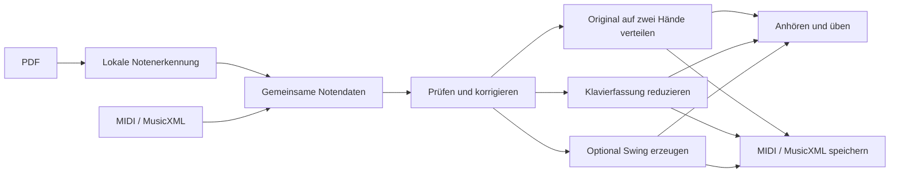
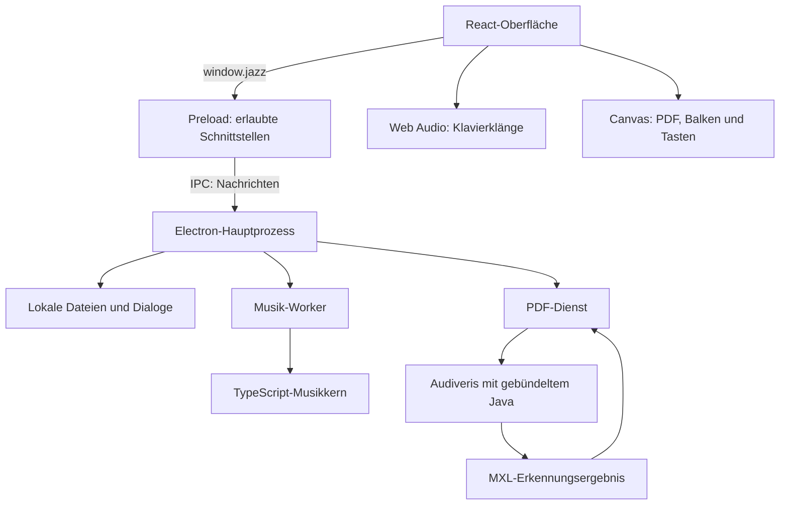

# Jazz Converter verstehen: Architektur und Software-Stack

Stand: Version 2.0.0. Diese Datei erklärt die tatsächlich implementierte App. Du kannst bei jeder Stufe aufhören und später eine Ebene tiefer weiterlesen.

| Lesestufe                                                                  | Für wen?                                    | Danach verstehst du …                                |
| -------------------------------------------------------------------------- | ------------------------------------------- | ---------------------------------------------------- |
| [1 – Überblick](#1--überblick-ohne-programmierwissen)                      | Ohne Programmierwissen, ca. 3 Minuten       | Was die Bausteine machen                             |
| [2 – Ein PDF durch die App begleiten](#2--ein-pdf-durch-die-app-begleiten) | Mit einem konkreten Beispiel, ca. 5 Minuten | Wie aus einer Partitur spielbare Klaviernoten werden |
| [3 – Aufbau und Stack](#3--aufbau-und-stack)                               | Einstieg in den Code, ca. 7 Minuten         | Welche Technik wo arbeitet und warum                 |
| [4 – Technische Details](#4--technische-details)                           | Zum Weiterentwickeln, ca. 10 Minuten        | Datenmodell, Algorithmen, Synchronisation und Tests  |

## 1 – Überblick ohne Programmierwissen

Die App arbeitet wie ein kleines Musikstudio mit fünf Arbeitsplätzen:

1. **Empfang:** Du suchst einen Song oder öffnest eine Datei.
2. **Notenleser:** Bei einem PDF werden die gedruckten Zeichen in einzelne Noten übersetzt. MIDI und MusicXML enthalten diese Informationen bereits.
3. **Arrangeur:** Die App prüft, welche Noten zwei Hände spielen können. Bei einer dichten Partitur wählt sie Melodie, Bass und wichtige Begleitnoten aus.
4. **Klavier und Übeanzeige:** Dieselben Noten werden hörbar und als fallende Balken sichtbar.
5. **Ausgabe:** Du speicherst MIDI oder MusicXML.



**Der wichtigste Gedanke:** Ein PDF ist zunächst nur eine bedruckte Seite. Eine MIDI-Datei enthält musikalische Ereignisse wie „spiele C4 ab Zeitpunkt 2 für eine Viertelnote“. MusicXML beschreibt zusätzlich die Notenschrift, etwa Stimmen, Notensysteme und Instrumente. Die App bringt alle Eingaben in eine gemeinsame interne Notenliste.

**Die drei musikalischen Ausgaben:**

- **Original:** Alle klingenden Noten passen auf zwei Hände. Tonhöhe, Beginn und Dauer bleiben erhalten. Exakte Unisono-Verdopplungen werden zu einem Tastendruck zusammengefasst.
- **Klavierfassung:** Die gesamte Besetzung passt nicht unverändert. Die App erhält die Hauptmelodie, wählt Bass und Begleitnoten und verteilt sie auf die Hände. Das Niveau ist Einfach oder Mittel.
- **Swing:** Als zusätzlicher Schritt entstehen geswingte Achtel, Jazzakkorde und eine neue Begleitung.

Die installierte App enthält die benötigten Programme, Erkennungsmodelle und Klavierklänge. Dein Vater braucht weder Java noch Node.js selbst zu installieren. Import, Erkennung, Arrangement, Wiedergabe und Export laufen auf seinem Mac. Nur das ausdrücklich angeklickte Herunterladen eines Songs benötigt Internet.

## 2 – Ein PDF durch die App begleiten

Angenommen, du öffnest eine Orchesterpartitur mit Flöte, B-Klarinette, Streichern und Cello.

### Schritt A: Original sichern und Seiten wählen

Die App kopiert das PDF in ihren eigenen Datenordner. Das Original bleibt unverändert. Eine Prüfsumme, **SHA-256**, dient als Fingerabdruck: Gleiche Bytes ergeben dieselbe Kennung.

Du siehst die Seiten, kannst hineinzoomen, Deckblätter auslassen und Seiten drehen. Die Drehung betrifft die Erkennungskopie. Das gespeicherte Original wird weiterhin unverändert angezeigt.

### Schritt B: Die gedruckten Noten lesen

Ein separat gestartetes Programm namens **Audiveris** erkennt Notenlinien, Schlüssel, Taktzeichen, Notenköpfe, Stimmen und weitere Symbole. **Tesseract** liest Texte, etwa Instrumentennamen. Das Ergebnis ist eine komprimierte MusicXML-Datei, also MXL.

Hier werden vortrainierte lokale Erkennungsmodelle eingesetzt. Das ist die zugelassene Ausnahme zur ursprünglichen Vorgabe ohne lokale KI. Das musikalische Arrangement selbst arbeitet mit festen Regeln. Es gibt keine KI-API und keinen Upload.

Die Erkennung kann etwas falsch lesen. Beispiel aus den Tests: Ein Teil des Taktzeichens wurde als zusätzliche Note erkannt. Dadurch enthielt ein 4/4-Takt fünf Viertel. Die App markiert diesen Widerspruch und öffnet die Prüfung, bevor sie eine Klavierfassung ausgibt.

### Schritt C: Eine gemeinsame musikalische Beschreibung erzeugen

Die App übersetzt MXL in ihr internes Modell. Eine Note enthält unter anderem:

> „Klingendes D4, Beginn bei Viertel 8, Dauer eine halbe Viertelnote, gespielt von der Klarinette; Fundstelle: Seite 2, Takt 3.“

Die **klingende Tonhöhe** ist wichtig: Bei einer B-Klarinette klingt ein notiertes C zwei Halbtöne tiefer. Deshalb werden notierte und klingende Tonhöhe getrennt gespeichert. MusicXML-Transpositionen haben Vorrang; eindeutige Instrumentenbezeichnungen liefern zusätzliche Hinweise. Du kannst die Transposition korrigieren.

### Schritt D: Zwei Hände prüfen

Die App untersucht die tatsächlich gleichzeitig gedrückten Tasten, einschließlich noch gehaltener Noten. Für eine unveränderte Zuordnung gelten:

- 88 Klaviertasten, von A0 bis C8;
- höchstens fünf gleichzeitig gedrückte Tasten je Hand;
- höchstens eine Oktave Abstand zwischen tiefster und höchster Taste derselben Hand.

Auch eine kleine Ensemblepartitur kann diese Prüfung bestehen. Die Instrumentenanzahl allein entscheidet deshalb nicht über die Reduktion. Eine Klavierpartitur mit extrem weiten Griffen kann umgekehrt eine Reduktion benötigen.

Diese Prüfung beschreibt die Tastenbelegung. Ob ein schneller Sprung bei einem bestimmten Tempo angenehm spielbar ist, braucht zusätzlich musikalisches Urteil.

### Schritt E: Bei Bedarf reduzieren

Die App sucht pro Takt nach der wahrscheinlichen Hauptmelodie. Dabei zählen zum Beispiel Instrumentenname, Tonlage, Einstimmigkeit und die Fortsetzung der vorherigen Melodie. So kann die Melodie zwischen Instrumenten wechseln. Du kannst eine bestimmte Stimme selbst auswählen.

Die Melodie kommt in die rechte Hand. Ganze Phrasen werden bei Bedarf um Oktaven versetzt. Links werden passende Basstöne aus der Quelle übernommen; weitere Quellnoten ergänzen die Harmonie. Zuerst entfallen Begleitnoten, die einen Griff unspielbar machen.

| Modus                      | Größte Griffweite je Hand | Links gleichzeitig | Rechts gleichzeitig |
| -------------------------- | ------------------------- | ------------------ | ------------------- |
| Original erhalten          | 12 Halbtöne               | 5                  | 5                   |
| Reduktion / Swing: Einfach | 7 Halbtöne                | 2                  | 3                   |
| Reduktion / Swing: Mittel  | 12 Halbtöne               | 3                  | 4                   |

Die Reduktion verwendet Quellmaterial. Der optionale Swing-Schritt ergänzt anschließend neue Jazzharmonik und Begleitung.

### Schritt F: Hören, üben, speichern

Die fertige Notenliste steuert gleichzeitig Klavierton, fallende Balken und leuchtende Tasten. Halbes Tempo verändert die Zeit, während die Tonhöhen gleich bleiben.

**MIDI speichern** erzeugt eine Metadatenspur und je eine Spur für linke und rechte Hand, beide mit akustischem Klavier. **MusicXML speichern** erzeugt die Klavierfassung mit zwei Notensystemen. **Erkannte Partitur speichern** exportiert das volle, gegebenenfalls korrigierte Quellmodell. Dieser Export rekonstruiert die Noteninformationen; das ursprüngliche Seitenlayout bleibt im Original-PDF erhalten.

## 3 – Aufbau und Stack

### Drei Bereiche innerhalb der Desktop-App

**Oberfläche:** React zeigt Sammlung, PDF-Vorschau, Korrekturen und Player. Diese Ansicht läuft in Electron, also in einem mitgelieferten Browserfenster.

**Desktop-Verwaltung:** Der Electron-Hauptprozess öffnet native Dateidialoge, verwaltet den lokalen Katalog und startet die Erkennung. Eine kleine Brücke namens `window.jazz` verbindet die Oberfläche mit diesen erlaubten Aktionen. Die Oberfläche erhält keinen freien Zugriff auf das Dateisystem. Die Content Security Policy (CSP) beschränkt geladene Inhalte auf die App. Für die mitgelieferten PDF-Bilddecoder ist WebAssembly erlaubt; JavaScript-Auswertung beliebiger Textprogramme bleibt im Produktionspaket gesperrt.

**Musikalischer Kern:** TypeScript-Funktionen importieren, analysieren und arrangieren Musik. Sie können ohne Oberfläche getestet werden. Aufwendige musikalische Aufträge laufen in einem Worker, damit die Oberfläche bedienbar bleibt. Die PDF-Erkennung läuft zusätzlich als eigener Java-Prozess.



**IPC** bedeutet hier nur: Zwei Teile der App schicken sich Nachrichten. Ein Beispiel ist „Speichere diese Klavierfassung als MIDI“. Der Hauptprozess prüft die Anfrage, öffnet den Dateidialog und schreibt die Datei.

### Verwendete Technik

Die Versionen stammen aus `package.json` beziehungsweise dem Ressourcenmanifest.

| Technik               | Version                  | Aufgabe                                                                                 |
| --------------------- | ------------------------ | --------------------------------------------------------------------------------------- |
| TypeScript            | 7.0.2                    | Programmiersprache mit Typprüfung; hilft, unpassende Daten früh zu finden               |
| React / React DOM     | 19.3.1                   | Benutzeroberfläche und deren Zustand                                                    |
| Electron              | 45.2.2                   | Desktop-Fenster, lokale Dateien, Dialoge und mitgelieferte Laufzeit                     |
| Web Audio API         | Teil des Browsers        | Lokale Klaviersamples zeitgenau abspielen                                               |
| Canvas API            | Teil des Browsers        | 88 Tasten und fallende Noten zeichnen                                                   |
| PDF.js (`pdfjs-dist`) | 6.5.438                  | PDF-Seiten lokal anzeigen; Fonts, Worker und WASM-Dateien sind mitgeliefert             |
| `pdf-lib`             | 1.17.1                   | PDF prüfen, ausgewählte Seiten kopieren und drehen                                      |
| Audiveris             | 5.11.0                   | Gedruckte Noten in MusicXML/MXL umwandeln                                               |
| OpenJDK / Zulu        | 25.0.3 im Paket          | Laufzeit für Audiveris; kein separater Java-Download nötig                              |
| Tesseract             | 5.5.2 im Audiveris-Paket | Instrumentennamen und Texte erkennen; englische/deutsche Sprachdaten aus tessdata 4.1.0 |
| `fast-xml-parser`     | 5.12.0                   | MusicXML und OMR-Metadaten lesen                                                        |
| `fflate`              | 0.8.3                    | MXL- und OMR-ZIP-Container öffnen                                                       |
| `midi-file`           | 1.2.4                    | Standard-MIDI lesen und schreiben                                                       |
| Zod                   | 4.6.7                    | Daten an den Schnittstellen und korrigierte Partituren prüfen                           |
| Lucide React          | 1.68.0                   | Symbole in der Oberfläche                                                               |
| Vite / esbuild        | 8.3.5 / 0.28.2           | Quellcode für Oberfläche und Desktop bündeln                                            |
| Vitest / Playwright   | 5.1.0 / 1.64.1           | Regeln testen und die echte Desktop-App bedienen                                        |
| electron-builder      | 26.18.0                  | Installationspakete für Apple Silicon und Intel erstellen                               |

**Entwicklungsumgebung:** Node.js 24 und npm. Die installierte App bringt ihre eigene Electron-Laufzeit mit. `@pdf-lib/fontkit`, Bravura und `@napi-rs/canvas` werden für die Herstellung der Testpartituren benutzt; sie bilden keinen zusätzlichen Notenerkennungsdienst.

### Orientierung im Repository

| Ort                                                | Zuständigkeit                                                 | Guter Einstieg                                |
| -------------------------------------------------- | ------------------------------------------------------------- | --------------------------------------------- |
| `src/App.tsx`                                      | Sammlung, Dateieingabe, Wechsel zwischen Ansichten            | Wie der Nutzer durch die App geht             |
| `src/components/PdfImport.tsx` und `PdfView.tsx`   | Seitenauswahl, Fortschritt und Vorschau                       | Der PDF-Einstieg                              |
| `src/components/ScoreReview.tsx`                   | Noten, Pausen, Stimmen, Taktmaß und Transposition korrigieren | Was die Prüfung tatsächlich ändern kann       |
| `src/components/ScoreWorkspace.tsx`                | Original, Reduktion, Speichern und optional Swing             | Der neue Arbeitsbereich                       |
| `src/core/model.ts`                                | Gemeinsame Datenbegriffe                                      | Zuerst `Note`, `Song` und `Arrangement` lesen |
| `src/core/import-xml.ts`, `import-midi.ts`         | Quelldateien ins gemeinsame Modell übersetzen                 | Importregeln                                  |
| `src/core/piano.ts`                                | Spielbarkeit, Melodieverfolgung und Reduktion                 | PDF-zu-Klavier-Logik                          |
| `src/core/convert.ts`, `arrange.ts`, `harmony.ts`  | Moduswahl und Swing-Regeln                                    | Arrangement verändern                         |
| `src/core/musicxml.ts`, `midi.ts`                  | Ausgaben erzeugen                                             | Dateiformate                                  |
| `src/core/time.ts`, `transport.ts`, `src/audio.ts` | Musikalische Zeit und Wiedergabe                              | Synchronisation                               |
| `desktop/main.ts`, `preload.ts`, `worker.ts`       | Desktop-Verwaltung und Nachrichten                            | App-Grenzen                                   |
| `desktop/pdf-service.ts`, `omr-metadata.ts`        | Audiveris-Aufträge, Cache, Instrumentenmetadaten              | Externe Erkennung integrieren                 |
| `scripts/`                                         | Ressourcen laden, bauen, testen und paketieren                | Entwicklung automatisieren                    |
| `tests/`                                           | Tests und eigene PDF-Referenzpartituren                       | Verhalten nachvollziehen                      |

### Wo liegen meine Daten?

Standardmäßig unter `~/Library/Application Support/Jazz Converter/`:

```text
songs/
  <Kennung>.json       Katalog, normalisierte/korrigierte Noten, Einstellungen
  <Kennung>.<Format>   Unveränderte MIDI/XML-Quelle bzw. rohes MXL-Ergebnis
pdfs/<PDF-Hash>/
  original.pdf        Unveränderte hochgeladene Datei
  document.json       Titel, Seitenanzahl, Scanhinweise
pdf-cache/<Auftrag>/
  job.json            Status und Ergebnisse
  input.pdf           Gewählte und gedrehte Seiten für die Erkennung
  recognition.log     Diagnose des Erkennungslaufs
  output/             Audiveris-MXL und OMR-Arbeitsdateien
omr-home/
  config/ data/ log/  Private Audiveris-Daten und mitgelieferte Sprachdateien
  native-cache/       Entpackte native Java-Hilfsbibliotheken
```

Ein Dateiname kann je nach Importformat abweichen. Original, Erkennungsdateien und korrigiertes Modell bleiben getrennt. Ein Klick auf „Geprüfte Noten übernehmen“ aktualisiert die JSON-Partitur. Bereits gespeicherte Exportdateien werden dadurch nicht automatisch geändert.

Die großen OMR-Laufzeitdateien liegen unter `resources/omr/` und sind nicht in Git eingecheckt. `npm run omr:assets` lädt die festgelegten Fassungen und baut die kleine Audiveris-Anpassung. Das fertige DMG enthält die zum jeweiligen Prozessor passende Laufzeit sowie gemeinsame Modelle, Lizenzen und Audiveris-Quellcode.

## 4 – Technische Details

### Datenmodell und Grenzen

Eine Notenzeit wird als Bruch in Viertelnoten gespeichert: `{n:1,d:2}` bedeutet eine Achtelnote. Das vermeidet viele Rundungsfehler bei Triolen und Taktwechseln. Die Umrechnung in Sekunden erfolgt erst für die Wiedergabe; die MIDI-Ausgabe quantisiert auf 960 Ticks je Viertel.

```ts
// Vereinfachtes Beispiel aus dem gemeinsamen Modell
const note = {
  id: "note-42",
  pitch: 62, // Klingendes D4, MIDI-Nummer
  writtenPitch: 64, // Notiertes E4 bei Transposition -2
  start: { n: 8, d: 1 },
  duration: { n: 1, d: 2 },
  velocity: 90,
  track: "clarinet-voice-1",
  partId: "P2",
  staff: 1,
  voice: "1",
  source: { page: 2, measure: 3, partId: "P2" },
};
```

`Song` enthält die volle Quelle mit Instrumenten, Stimmen, Pausen, Takten, Tempo und Erkennungshinweisen. `Arrangement` enthält die fertigen spielbaren Noten mit `hand: 'left' | 'right'` und den verwendeten Einstellungen. `sourceIds` verbinden übernommene Noten mit ihrer Herkunft. Fundstellen führen zur PDF-Seite und zum Takt; die Oberfläche bietet keine pixelgenaue Erkennungsrahmen- oder Notenkopfmarkierung.

### Exakte Handzuordnung

`assignHands()` in `piano.ts` führt eine Suche über zulässige Handbelegungen aus:

1. Exakt gleiche Tonhöhe, Startzeit und Dauer werden als gemeinsamer Tastendruck behandelt.
2. Beim nächsten Anschlagszeitpunkt werden bereits beendete Töne aus der Belegung entfernt.
3. Für neue Töne werden mögliche Zuordnungen links/rechts untersucht.
4. Belegungen außerhalb von 88 Tasten, fünf Fingern oder zwölf Halbtönen werden verworfen. Noch gehaltene Tasten bleiben dabei verbindlich.
5. Unter gleichwertig zulässigen Wegen bevorzugt eine Kostenfunktion passende Notensysteme und kleine Bewegungen.

Die Präferenzkosten wählen einen Weg; sie beschneiden die zulässige Suche nicht. Die Spielbarkeit ist dadurch eine Prüfung des ganzen Notenverlaufs und nicht nur jedes Akkords für sich. Zwei überlappende erneute Anschläge derselben Taste werden vorsichtshalber als nicht unverändert übertragbar eingestuft.

### Reduktion und Swing

`melodySegments()` bewertet Stimmen taktweise und führt benachbarte Abschnitte derselben Melodiestimme zusammen. `sourceMelody()` schneidet passende Notenabschnitte aus der Quelle aus. Die Bewertung ist eine nachvollziehbare Heuristik; eine musikalisch falsche Auswahl bleibt möglich. Geringe Sicherheit erzeugt einen Hinweis, und die Stimme kann gewechselt werden.

`reducePiano()` übernimmt die Melodielinie, oktaviert zusammenhängende Phrasen und ergänzt Quellbass sowie harmonische Quellnoten. Neue Begleitnoten werden nur übernommen, wenn die Griffprüfung einschließlich gehaltenen Noten weiter besteht. Die Reihenfolge und Auswahl sind festgelegt.

`convertArrangement()` ist die gemeinsame Eingangsfunktion für Original, Reduktion und Swing. `arrange.ts` übernimmt die vorhandenen Swing-Regeln. Bei automatischer Melodieverfolgung wird für Swing eine virtuelle Melodiespur aus der zuvor bestimmten Linie erstellt.

### Warum MIDI-Dateien reproduzierbar sind

Der musikalische Kern verwendet keine Zufallszahlen, Uhrzeiten oder generative Modelle zur Notenauswahl. Sortierreihenfolgen, Griffkosten, Oktavwahl und Exportreihenfolge sind festgelegt. Die Engine-Version ist Teil der Exportmetadaten.

**Die automatische Garantie und ihre Testgrenze:** Dasselbe normalisierte Quellmodell mit denselben Einstellungen und derselben Engine-Version erzeugt bytegleiche MIDI-Dateien. Die Tests vergleichen diese Bytes direkt. Zusätzlich wurden Klavier-PDF und Orchester-Scan jeweils mit frischem OMR-Arbeitsordner erneut erkannt; ihre MIDI-Dateien stimmen in beiden Stufen bytegenau mit dem ersten Lauf überein. Dieser Vergleich gilt für die getestete Apple-Silicon-Umgebung. PDF-Erkennung ist ein vorgelagerter Prozess mit eigenen Modellen und Laufzeitfassungen; OMR-Arbeitsarchive enthalten zusätzliche Metadaten. Eine allgemeine Bytegleichheit der Erkennungsarchive oder identische OCR über unterschiedliche Mac-Architekturen wird nicht behauptet.

### Eine Uhr für Ton und Bild

Der `Transport` kennt Noten, Tempokarte, aktuelle Position, Geschwindigkeit, Handauswahl und Wiederholungsbereich. Seine Zeitbasis ist die Uhr des `AudioContext`.

- Der Player plant Klänge ungefähr 120 ms voraus, um kleine Verzögerungen der Oberfläche abzufangen.
- Die Anzeige fragt die Position desselben Transports ab. Für die Darstellung wird nach Möglichkeit der Audio-Ausgabezeitstempel berücksichtigt.
- Bei Sprung, Tempowechsel, Pause oder Handauswahl werden alte Klänge gestoppt und der Transport neu verankert.
- Töne, die an der neuen Position noch gehalten werden, werden mit passender Restdauer wiederhergestellt.

Das Übetempo skaliert die Abstände und Dauern. Die Sample-Tonhöhe folgt weiter ausschließlich der Notenhöhe. Exportiert wird das musikalische Arrangement mit seiner Tempokarte; die aktuelle Übeeinstellung verändert die Datei nicht.

### PDF-Aufträge und Fehlerbehandlung

`PdfService` verarbeitet einen Erkennungsauftrag gleichzeitig. Seine Zustände sind `queued`, `running`, `complete`, `error` und `cancelled`. Die Oberfläche fragt den Status alle 750 ms ab.

Der Auftragsschlüssel enthält PDF-Fingerabdruck, Seiten, Drehung, Ressourcenmanifest und Normalisierungsfassung. Dadurch können abgeschlossene Erkennungen wiederverwendet werden. Nach einem App-Neustart werden unterbrochene Aufträge als Fehler mit Wiederholungsangebot angezeigt. Abbrechen beendet den Java-Prozess und lässt das Original erhalten.

Grenzen: maximal 100 MB je PDF, maximal 200 gewählte Seiten pro Auftrag, Java mit maximal 3 GB Heap. Das Zeitlimit liegt abhängig von der Seitenzahl zwischen fünf und 45 Minuten. Sehr große oder komplizierte Partituren können diese Grenzen erreichen.

`ReviewIssue` trennt Hinweise von blockierenden Fehlern. Überfüllte Takte, bestimmte nicht unterstützte Schreibweisen und gemeldete OMR-Problemstellen führen zur Prüfung. Eine einfache DPI-Heuristik warnt bei als Vollseitenbild erkannten Scans unter 200 dpi. Diese Kontrollen erkennen nicht jeden falschen Ton. Die Prüffreigabe ist eine bewusste Bestätigung des Nutzers.

Audiveris erhält einen privaten Arbeitsordner. Die kleine, mitgelieferte Änderung an `WellKnowns.getFolder()` erlaubt dafür eine Java-Systemeigenschaft. Die Shell-Variable `HOME` und eine vorhandene Audiveris-Installation werden nicht umgestellt. Der geänderte Quellcode und die Bauanleitung liegen dem Paket bei.

### Prüfungen selbst ausführen

Nach `npm ci` und dem Beschaffen der OMR-Ressourcen:

```sh
npm test                 # Import, Handregeln, Reduktion, XML/MIDI, Transport
npm run build            # Typprüfung und Produktionsbuild
npm run verify:pdf       # Echte Java-Erkennung auf Referenz-PDFs und Scans
npm run test:e2e         # Bisheriger vollständiger Offline-Desktopablauf
npm run test:e2e:pdf     # PDF-Vorschau bis Korrektur und Export in Electron
npm run package          # Beide macOS-DMGs bauen
npm run verify:package   # DMGs und Signaturen, arm64-App direkt daraus testen
```

Build und GUI-Test nacheinander ausführen: Ein laufender Test soll nicht gleichzeitig neu erzeugte App-Dateien lesen. Die Tests benutzen eigene temporäre Datenordner. Ergebnisse und Screenshots liegen in `test-results/`; der Abnahmestand steht in [ABNAHME.md](ABNAHME.md).

### Grenzen dieser Version

Gedruckte, gut lesbare Noten sind der Zielbereich. Handschrift, Fotos mit starkem Schrägwinkel, Spracheingabe und MP3-Transkription werden nicht unterstützt. Schlechte Scans und komplexe Orchesterpartituren können erhebliche manuelle Korrekturen brauchen. Verzierungen, seltene Spielanweisungen und komplexe Navigation werden nicht vollständig in eine Aufführung übersetzt.

Die Klavierfassung bewahrt nicht die Klangfarben eines Orchesters. Die Originalprüfung bewertet Griffbelegung und Tonumfang; sie ersetzt keine vollständige pianistische Bewertung von Tempo, Sprüngen, Fingersatz und Ausdruck. Ein menschlicher Hörvergleich, die wahrgenommene Audio-Bild-Synchronität auf dem Zielgerät und ein nativer Intel-Test bleiben eigene Abnahmeschritte.
